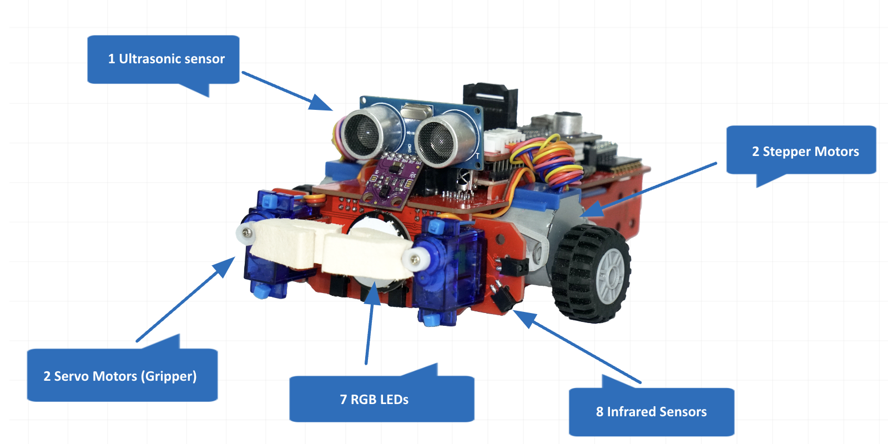
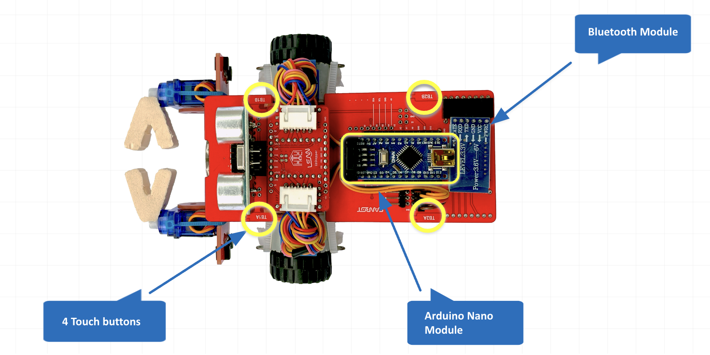
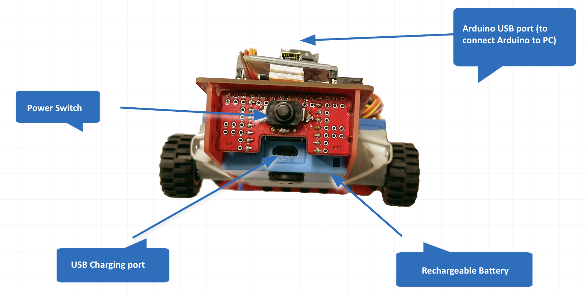

# Bài 0 — Làm quen và kiểm tra Leanbot

Đây là bản tiếng Việt của phần **System Configuration** trong khóa gốc: 7 chương, mỗi chương
một video và một bộ câu hỏi. Khóa gốc đặt phần này **trước mọi bài lập trình**, và đúng như
vậy: chưa cầm được robot, chưa sạc được, chưa biết nó còn sống hay không thì học lập trình
vô nghĩa.

Bài này **không dạy một dòng code nào**. Nó dạy cầm robot, sạc robot, kiểm tra từng bộ phận,
và hiệu chỉnh khi bộ phận chạy sai.

| Chương gốc | Phần trong bài này |
|---|---|
| SC1 · What is LEANBOT Standard Kit? | §1 |
| SC2 · How to charge your LEANBOT? | §3 |
| SC3 · Taking Care of your LEANBOT | §4 |
| SC4 · How to check sensors and actuators? | §5 |
| SC5 · How to calibrate Gripper? | §6 |
| SC6 · How to calibrate RGB LEDs? | §6 |
| SC7 · How to calibrate Stepper Motors? | §6 |

§2 và §7 là phần chúng ta thêm vào: hai cổng USB dễ cắm nhầm, và cách nạp code. Khóa gốc
không có §2, còn §7 nằm rải rác ở nơi khác.

## Bé học xong thì làm được gì

Đây là danh sách để **chấm**, không phải để đọc. Bé làm được từng việc thì tích vào:

- [ ] Chỉ đúng 6 bộ phận trên robot thật: mắt siêu âm, hai bánh, tay gắp, đèn LED, mắt hồng ngoại, nút chạm.
- [ ] Nói đúng **não robot là Arduino Nano**, không phải Uno.
- [ ] Chỉ đúng **cổng nạp code** và **cổng sạc**, nói được vì sao không được cắm nhầm.
- [ ] Tự cắm sạc, nhìn đèn báo và nói được **đang sạc** hay **đã đầy**.
- [ ] Bật robot, xác nhận robot đang sống.
- [ ] Nạp chương trình kiểm tra vào robot, mở cửa sổ `SERIAL`, **đọc được dòng số liệu** mà robot gửi về.
- [ ] Gõ lệnh kiểm tra từng bộ phận, và nói được bộ phận nào tốt, bộ phận nào hỏng.
- [ ] Biết phải hiệu chỉnh khi bộ phận chạy sai, và hiệu chỉnh ở đâu.

## §1. Leanbot gồm những gì



| Số lượng | Bộ phận | Để làm gì | Học ở bài |
|---|---|---|---|
| 1 | Mắt siêu âm | Đo khoảng cách tới vật phía trước | Bài 3 |
| 2 | Động cơ bước (bánh xe) | Tiến, lùi, quay | Bài 1 |
| 2 | Động cơ servo (tay gắp) | Mở, đóng càng | Bài 2 |
| 7 | Đèn LED nhiều màu | Báo trạng thái, báo màu khối | Bài 2, 14 |
| 8 | Mắt hồng ngoại | Dò vạch đen và phát hiện vật hai bên | Bài 4 |
| 4 | Nút chạm | Ra lệnh cho robot bắt đầu | Bài 1 |

**Tám mắt hồng ngoại chia làm hai nhóm, đừng nhầm:**

| Nhóm | Tên trong code | Việc |
|---|---|---|
| 4 mắt **dưới bụng** | `ir0L  ir1R  ir2L  ir3R` | Nhìn vạch đen dưới sàn — dùng để bám vạch |
| 4 mắt **hai bên** | `sir4L  sir5R  sir6L  sir7R` | Nhìn vật ở hai bên thân robot |

Hai nhóm này dùng hàm khác nhau trong code: nhóm bụng đọc bằng `LbIRLine.read()`, nhóm bên
đọc bằng `LbIRSensor.read(sir6L)`. Lẫn hai nhóm là nguyên nhân rất hay gặp khi bé viết bài
bám vạch.

### Bốn nút chạm nằm ở đâu



Nút chạm có tên in ngay trên bảng mạch: **`TB1A`, `TB1B`** ở **phía trước** (gần tay gắp),
**`TB2A`, `TB2B`** ở **phía sau**. Nhớ điều này vì hầu hết chương trình mẫu đều bắt đầu bằng

```cpp
LbMission.begin( TB1A + TB1B );   // chạm cùng lúc HAI nút trước thì mới khởi động
```

Phải chạm **cùng lúc cả hai nút trước**. Chạm một nút thì robot không chạy — bé hay tưởng
chương trình hỏng.

### Não robot

Trong ảnh trên, hình chữ nhật khoanh vàng ở giữa là **Arduino Nano Module** — bộ não.
Cạnh nó là **mô-đun Bluetooth**, dùng cho Bản Sao Số ở Bài 10.

> **Điểm dễ nhầm nhất của cả bài.** Não là **Arduino Nano**, nhưng khi nạp code, trình soạn
> thảo lại để `BOARD: ARDUINO UNO`. Hai con chip này chạy cùng một bộ nạp nên đặt `UNO` vẫn
> nạp được. Khóa gốc hỏi "robot brain là gì" và đáp án đúng là **Arduino NANO**; còn màn hình
> IDE thì ghi `UNO`. Cả hai đều không sai, chỉ là hai chuyện khác nhau.

## §2. Hai cổng USB — chỗ sai nhiều nhất



Mặt sau robot có **hai cổng USB nằm gần nhau**, làm hai việc hoàn toàn khác nhau:

| Cổng | Vị trí | Dùng để | Cắm nhầm thì sao |
|---|---|---|---|
| **Cổng Arduino** | **Phía trên**, trên mạch Nano | **Nạp code** | Cắm vào cổng sạc thì máy tính không thấy robot, cửa sổ chọn cổng trống trơn |
| **Cổng sạc** | **Phía dưới**, trên cục pin | **Chỉ sạc pin** | Cắm vào cổng Arduino thì pin không vào điện |

Cũng ở mặt sau: **công tắc nguồn** và **cục pin sạc**.

Khi bé kêu "máy không nhận robot", hỏi câu đầu tiên là: **cắm vào cổng trên hay cổng dưới?**

## §3. Sạc robot

Video gốc: <https://youtu.be/hfoZm4PWt6M>

**Hai cách sạc, chỉ hai:**

1. Cáp USB nối vào **máy tính**.
2. **Củ sạc** cắm thẳng vào ổ điện.

Cáp là loại **USB-C sang USB-A**. (Khóa gốc có một câu hỏi bẫy: "Leanbot sạc được bằng 3
cách, cách thứ ba là tự quay bánh thật nhanh để tự sạc" — **sai**.)

**Nhìn đèn trên cục pin để biết tình trạng:**

| Đèn | Nghĩa |
|---|---|
| **Nháy đỏ** | Đang sạc |
| **Xanh dương, không nháy** | Đã sạc đầy |

Sạc đầy mất khoảng **2–4 tiếng**. Pin yếu thì hai động cơ không còn khoẻ bằng nhau, robot
chạy lệch dù code đúng từng chữ. **Robot "tự nhiên chạy sai" thì nghĩ tới pin trước khi nghĩ
tới code.**

## §4. Giữ gìn robot

Video gốc: <https://youtu.be/BS4ZiNJZEhM>

Ba điều khóa gốc nhấn mạnh:

1. **Các bộ phận KHÔNG lắp lẫn cổng được.** Mắt siêu âm có cổng riêng của nó, không cắm vào
   cổng trống bất kỳ được. Đây là một câu đúng/sai trong khóa gốc, và đáp án là **sai** —
   tức không lắp lẫn được.
2. **Không dùng thì cất vào hộp.** Không để robot ngoài bàn, không phơi nắng.
3. **Sạc đều đặn**, để robot luôn đủ điện làm việc.

## §5. Kiểm tra cảm biến và cơ cấu

Video gốc: <https://youtu.be/i-EFK6lf2as>

Đây là phần quan trọng nhất của bài, và là thứ khóa gốc gọi là *Calibration Tools*.

### Lấy chương trình kiểm tra ở đâu

Kho: **`git.pythaverse.space/leanbot/Tools`**

| Tệp | Việc |
|---|---|
| `Sample Code/Leanbot_Test_and_Demo_v1.ino` | **Chương trình kiểm tra toàn bộ** — dùng cái này |
| `Nano_CH340_Driver_Installer.exe` | Trình cài driver CH340 cho **Windows** |
| `Remote_Control.ino` | Điều khiển robot từ xa |

Khóa gốc còn nhắc các tệp `Gripper_Calibration.ino`, `Gripper_Troubleshooting.ino`,
`Step_Motor_Calibration.ino`, `Test_Touch_Sensor.ino`. **Bốn tệp này không có trong kho
`Tools`** — xem mục "Ghi chú về bản gốc".

### Thứ tự làm — đúng thứ tự này

Khóa gốc hỏi hẳn một câu về thứ tự, vì làm sai thứ tự là hỏng:

| Bước | Làm gì |
|---|---|
| 1 | Mở `ide.pythaverse.space/#/code` |
| 2 | Dán nội dung `Leanbot_Test_and_Demo_v1.ino` vào |
| 3 | **Bật nguồn robot** |
| 4 | Cắm cáp vào **cổng Arduino** (cổng trên) |
| 5 | Bấm nút nạp (biểu tượng có hình play) |
| 6 | Chờ `100% – Done!` |
| 7 | Mở cửa sổ **`SERIAL`** |

Bước 3 **phải trước** bước 5. Câu hỏi trong khóa gốc: "sau khi dán code vào IDE thì làm gì?"
— đáp án đúng là **bật nguồn robot**, không phải biên dịch ngay.

### Đọc dòng số liệu robot gửi về

Sau khi nạp xong và mở `SERIAL`, robot gửi về liên tục một dòng như thế này:

```
TB 0000 - IR 00 .... 00 - 23 cm - GR 50 50
```

Đọc từng khúc:

| Khúc | Nghĩa | Thế nào là tốt |
|---|---|---|
| `TB 0000` | Bốn nút chạm, theo thứ tự `TB1A TB1B TB2A TB2B` | Không chạm là `0000`. Chạm nút nào thì số đó thành `1` |
| `IR 00 .... 00` | Hai mắt hồng ngoại trái, bốn mắt dò vạch, hai mắt phải | Để robot trên nền trắng rồi trên vạch đen, số phải đổi |
| `23 cm` | Mắt siêu âm đo khoảng cách | Đưa tay lại gần, số phải nhỏ đi |
| `GR 50 50` | Góc hai càng tay gắp, trái và phải | Mở/đóng càng thì hai số phải đổi |

**Cách kiểm nhanh từng bộ phận:** chạm từng nút xem số có nhảy không; đưa tay trước mắt siêu
âm xem cm có giảm không; đặt robot lên vạch đen xem phần `IR` có đổi không. Bộ phận nào số
không đổi thì bộ phận đó có vấn đề.

### Tám lệnh chạy thử

Gõ vào ô nhập của cửa sổ `SERIAL` rồi Enter. Tên lệnh **viết hoa chữ đầu, không dấu cách**:

| Gõ lệnh này | Robot làm gì | Nhìn gì để biết tốt |
|---|---|---|
| `Motion` | Tiến 10 cm, lùi 10 cm, quay phải 90°, quay trái 90° | Về đúng chỗ cũ, đúng hướng cũ |
| `StraightMotion` | Chạy thẳng 1 mét rồi lùi về | Đi thẳng, không lệch sang bên |
| `Gripper` | Đóng càng, chờ 1 giây, mở càng | Hai càng khép và mở đều nhau |
| `RGBLeds` | Bật 7 đèn màu ngẫu nhiên rồi tắt | Cả 7 đèn đều sáng |
| `Buzzer` | Kêu 8 nốt: đô rê mi fa sol la si đô | Nghe đủ 8 nốt, cao dần |
| `LineFollow` | Bám vạch đen cho tới khi gặp ngã tư | Bám được vạch, dừng ở ngã tư |
| `Objectfollow` | Bám theo vật phía trước, giữ cách 15 cm | Đưa tay ra xa thì robot tiến, lại gần thì robot lùi |
| `IRLine` | Vào chế độ **hiệu chỉnh mắt dò vạch** | Xem §6 |

Tám lệnh này phủ đúng mọi bộ phận trong §1. Chạy hết tám lệnh mà đều đúng thì robot lành
lặn, bắt đầu học Bài 1 được.

## §6. Hiệu chỉnh khi bộ phận chạy sai

Ba video gốc: tay gắp <https://youtu.be/pp1wQUnQceo> · đèn LED
<https://youtu.be/XUh6FlSeuWY> · động cơ bước <https://youtu.be/KGyC57e1b7o>

**Hiệu chỉnh** nghĩa là chỉnh cho bộ phận chạy đúng, không phải sửa chữa. Khóa gốc dạy một
nếp làm chung cho cả ba, và hỏi đi hỏi lại ba ý này:

| Hỏi | Đáp |
|---|---|
| Vì sao phải hiệu chỉnh? | Để bộ phận **chạy đúng và chính xác hơn** — không phải để nhanh hơn hay đẹp hơn |
| Trước khi hiệu chỉnh phải làm gì? | **Chuẩn bị đủ dụng cụ** trước đã |
| Làm sao biết hiệu chỉnh xong? | **Thử lại chính việc đó**: tay gắp thì thử gắp, đèn thì thử xem màu có đúng không |
| Đang hiệu chỉnh mà vẫn sai thì sao? | **Xem phần khắc phục sự cố** — đừng bỏ qua, cũng đừng làm lại từ đầu |

### Hiệu chỉnh mắt dò vạch — việc duy nhất có quy trình rõ trong mã

Gõ lệnh `IRLine` trong cửa sổ `SERIAL`. Chương trình gọi:

```cpp
LbIRLine.doManualCalibration(TB1A);
```

Nghĩa là: robot chờ bé **chạm nút `TB1A`** để lấy mẫu. Quy trình: đặt robot lên **nền trắng**
rồi chạm nút, rồi đặt lên **vạch đen** rồi chạm nút. Robot ghi lại hai mức sáng đó và tự
tính ngưỡng phân biệt.

Ngưỡng mặc định trong chương trình là **60** cho cả bốn mắt:

```cpp
LbIRLine.setThreshold(60, 60, 60, 60);
```

Sàn nhà mỗi nơi một màu nên số 60 không phải lúc nào cũng hợp. Dò vạch chập chờn thì hiệu
chỉnh lại, đừng sửa code vội.

## §7. Nạp code vào robot

Phần này khóa gốc không gom vào System Configuration, nhưng không có nó thì §5 không làm
được.

### Nút nạp nằm ở đâu


Tài liệu Pythaverse gọi nó là nút `Compile & Upload`. **Trên màn hình không có chữ đó** — chỉ
có biểu tượng:

| Biểu tượng | Làm gì |
|---|---|
| `< >` có dấu **tích** | **Chỉ biên dịch**, không nạp vào robot |
| Màn hình có nút **play** | **Biên dịch rồi nạp** — nút đúng |
| `>_` **SERIAL** | Mở cửa sổ xem số liệu robot gửi về |

Bé hay bấm nhầm biểu tượng thứ nhất rồi tưởng đã nạp xong: nó cũng báo thành công, nhưng
robot không nhận gì.

### Thanh dưới cùng phải đúng ba thứ


| Chữ | Phải là |
|---|---|
| `SELECT DEVICE` | Sau khi chọn cổng sẽ thành `SERIAL: SELECTED` |
| `BOARD` | `ARDUINO UNO` hoặc `ARDUINO NANO` |
| `SERVER` | `ONLINE` — chữ này không xanh thì chưa nạp được, phải chờ |

### Sáu bước nạp

| Bước | Làm gì | Thấy gì |
|---|---|---|
| 1 | Mở trình soạn thảo, chương trình đã sẵn sàng | — |
| 2 | **Bật công tắc robot** | Đèn đỏ sáng |
| 3 | Cắm cáp vào **cổng Arduino** (cổng trên!) | — |
| 4 | Bấm nút **play** | Cửa sổ Chrome hỏi chọn cổng |
| 5 | Chọn cổng → `Connect` | 25 % → 50 % → `100% – Done!` |
| 6 | Rút cáp | Robot chạy chương trình mới |

Nghe tiếng bíp để biết: **một bíp** là bắt đầu nạp; **một bíp rồi "bíp bíp"** là xong, robot
sẵn sàng. **Không rút cáp khi đang nạp.**

**Cửa sổ chọn cổng hiện ra mà danh sách trống** → rút cáp, cắm lại, chọn lại. Không cần tải
lại trang.

### Phải dùng Chrome hoặc Edge

Nút nạp chạy bằng **WebSerial**. Firefox và Safari không có tính năng này, nên bấm nút sẽ
không mở được cổng nào. Không phải robot hỏng.

### Windows: cài driver CH340

Robot dùng chip CH340 để nói chuyện với máy tính. Windows thường cần cài driver:
chạy `Nano_CH340_Driver_Installer.exe` trong kho `leanbot/Tools`.

### Linux: hai cái bẫy

Bỏ qua mục này nếu dùng Windows hoặc macOS.

**Bẫy 1 — `brltty` giật mất cổng.** `brltty` là phần mềm hỗ trợ màn hình chữ nổi, có sẵn
trong Ubuntu, và nó nhận nhầm chip CH340 là màn hình chữ nổi. Cổng sinh ra rồi mất sau một
giây:

```
ch341-uart converter now attached to ttyUSB0
usbfs: interface 0 claimed by ch341 while 'brltty' sets config #1
ch341-uart converter now disconnected from ttyUSB0
```

Xem bằng `journalctl -k | grep ch341`. Sửa:

```bash
sudo systemctl stop brltty-udev.service
sudo systemctl mask brltty-udev.service brltty.service
```

Lệnh này tắt hẳn hỗ trợ màn hình chữ nổi trên máy đó.

**Bẫy 2 — không có quyền mở cổng.**

```bash
sudo usermod -aG dialout "$USER"
```

Phải **đăng xuất rồi đăng nhập lại**, vì Chrome đang mở thừa hưởng nhóm từ lúc nó khởi động.

**Hai bẫy cho hai triệu chứng khác hẳn nhau:**

| Thấy gì | Bẫy nào |
|---|---|
| Cửa sổ chọn cổng **trống** | Bẫy 1 — `brltty` |
| Biên dịch xong tới ~50 % rồi báo `*** Upload Error: Failed to execute 'open' on 'SerialPort'` | Bẫy 2 — thiếu nhóm `dialout` |

Thông báo thứ hai hay làm người ta tưởng robot hỏng, vì dòng ngay trên nó in
`Sketch uses 11918 bytes (36%) of program storage space` — code đã biên dịch xong hoàn toàn,
chỉ riêng bước mở cổng bị từ chối.

Kiểm phiên hiện tại đã có nhóm chưa:

```bash
id -nG | tr ' ' '\n' | grep -x dialout
```

## Câu hỏi của khóa gốc, dịch sang tiếng Việt

Đây là nguyên văn phần *Check Your Understanding* của 7 chương, đã dịch. Đáp án đúng đánh
dấu ✔. Dùng để chấm, vì bé sẽ gặp đúng những câu này trên Plearn.

**Chương 1 — Leanbot Standard Kit**

1. Leanbot dùng gì làm não robot? — Arduino UNO · **✔ Arduino NANO** · Arduino Mega 2560 Rev 3 · Arduino Uno Wifi Rev 2
2. Leanbot có mấy động cơ bước? — **✔ 2** · 3 · 4 · 5
3. Đúng hay sai: Leanbot chạy bằng 2 viên pin Li-ion sạc lại được nằm trong cục pin. — **✔ Đúng**
4. Bộ phận nào giúp Leanbot tiến, lùi và quay? — **✔ Động cơ bước** · Động cơ servo · Đèn LED · Nút chạm
5. Đúng hay sai: Bật Leanbot bằng công tắc ở **phía sau** robot. — **✔ Đúng**

**Chương 2 — Sạc robot**

6. Dùng gì để sạc Leanbot? — Đế sạc không dây · **✔ Cáp USB-C sang USB-A** · Tấm pin mặt trời · Cáp USB-A sang USB-B
7. Đúng hay sai: Cục pin **nháy đỏ** khi đang sạc và **xanh dương đứng yên** khi đã đầy. — **✔ Đúng**
8. Đúng hay sai: Leanbot sạc được bằng 3 cách: 1) cáp USB nối máy tính, 2) củ sạc cắm ổ điện, 3) tự quay bánh thật nhanh để tự sạc. — **✔ Sai** (chỉ có 2 cách đầu)

**Chương 3 — Giữ gìn robot**

9. Đúng hay sai: Các bộ phận của Leanbot lắp lẫn cổng được, ví dụ cắm mắt siêu âm vào cổng trống bất kỳ. — **✔ Sai**
10. Không dùng thì để robot ở đâu? — Để ngoài trời · **✔ Cất vào hộp của nó** · Cất tủ lạnh · Phơi nắng
11. Vì sao phải sạc robot đều đặn? — Cho bóng đẹp · **✔ Để robot đủ điện làm việc** · Cho ấm máy · Cho robot im lặng

**Chương 4 — Kiểm tra cảm biến và cơ cấu**

12. Bộ công cụ hiệu chỉnh của Leanbot dùng để làm gì? — Thiết kế robot mới · **✔ Kiểm tra và hiệu chỉnh cảm biến, cơ cấu** · Lập trình game · Biên dịch phần mềm
13. Tệp nào dùng để khắc phục sự cố tay gắp? — `Step_Motor_Calibration.ino` · `Gripper_Calibration.ino` · **✔ `Gripper_Troubleshooting.ino`** · `Test_Touch_Sensor.ino`
14. Dán code vào IDE xong thì làm gì? — Biên dịch · Lưu lại · **✔ Bật nguồn robot** · Đóng IDE
15. Lấy kho công cụ hiệu chỉnh ở đâu? — **✔ `https://git.pythaverse.space/`** · `ide.pythaverse.space` · `leanbot.com` · `calibrationtools.com`

**Chương 5 — Hiệu chỉnh tay gắp**

16. Làm sao biết tay gắp chạy tốt? — Xem màu càng · **✔ Thử xem tay gắp làm được gì** · Cân nặng càng · Sơn lại càng
17. Vì sao phải hiệu chỉnh tay gắp? — Cho nhanh hơn · **✔ Cho chạy đúng và chính xác hơn** · Cho đổi màu · Cho nhẹ hơn
18. Trước khi hiệu chỉnh phải làm gì? — **✔ Chuẩn bị đủ dụng cụ** · Sơn càng · Làm ấm phòng · Không cần gì
19. Đang hiệu chỉnh mà tay gắp vẫn sai thì sao? — Bỏ qua, làm tiếp · Làm lại từ đầu · **✔ Xem phần khắc phục sự cố** · Thay càng mới

**Chương 6 — Hiệu chỉnh đèn LED**

20. Đang hiệu chỉnh mà đèn lên sai màu thì sao? — Bỏ qua · Làm lại từ đầu · **✔ Xem phần khắc phục sự cố** · Thay đèn mới
21. Làm sao biết hiệu chỉnh đèn thành công? — **✔ Thử xem đèn lên đúng màu không** · Xem độ sáng · Đo kích thước đèn · Sơn lại đèn
22. Vì sao phải hiệu chỉnh đèn? — Cho sáng hơn · **✔ Cho màu lên đúng** · Tiết kiệm pin · Đổi kích thước
23. Trước khi hiệu chỉnh phải làm gì? — Sơn đèn · **✔ Chuẩn bị đủ dụng cụ, vật liệu** · Làm ấm phòng · Không cần gì

**Chương 7 — Hiệu chỉnh động cơ bước**

Bốn câu, cùng một nếp với chương 5 và 6: vì sao phải hiệu chỉnh, cần chuẩn bị gì trước,
động cơ chạy sai thì làm gì, làm sao biết đã xong.

## Phiếu ôn luyện

**Câu 1.** Robot của bé cắm cáp vào máy nhưng cửa sổ chọn cổng trống trơn, dù pin còn đầy.
Hỏi câu gì đầu tiên?

**Đáp án:** Cắm vào **cổng nào**. Robot có hai cổng USB sát nhau: cổng Arduino ở trên dùng
để nạp code, cổng sạc ở dưới chỉ để sạc. Cắm vào cổng sạc thì máy tính không thấy robot.

**Câu 2.** Bé nói "robot hỏng rồi, bấm nút chạm mà không chạy". Chương trình bắt đầu bằng
`LbMission.begin( TB1A + TB1B )`. Hỏi bé điều gì?

**Đáp án:** Có chạm **cùng lúc cả hai** nút trước không. `TB1A + TB1B` nghĩa là phải chạm hai
nút trước cùng lúc; chạm một nút thì robot đứng im. Robot không hỏng.

**Câu 3.** Cục pin đang **nháy đỏ**. Robot đã sạc xong chưa?

**Đáp án:** **Chưa**. Nháy đỏ là đang sạc. Xong là **xanh dương đứng yên, không nháy**.

**Câu 4.** Bé nạp chương trình kiểm tra, mở `SERIAL`, thấy dòng
`TB 0000 - IR 00 .... 00 - 23 cm - GR 50 50`. Bé chạm nút `TB1A` nhưng dòng vẫn là `TB 0000`.
Kết luận gì?

**Đáp án:** Nút `TB1A` **không ăn**. Chạm đúng nút thì chữ số đầu tiên phải đổi thành `1`
(`TB 1000`). Trước khi kết luận hỏng, thử chạm ba nút còn lại: nếu cả bốn đều không đổi thì
nhiều khả năng chưa nạp đúng chương trình chứ không phải hỏng nút.

**Câu 5.** Gõ lệnh nào để nghe robot kêu 8 nốt nhạc?

**Đáp án:** `Buzzer`. Tám nốt là đô rê mi fa sol la si đô. Nghe thiếu nốt hoặc không nghe gì
thì loa có vấn đề.

**Câu 6.** Robot dò vạch chập chờn: lúc bám được, lúc chạy ra ngoài. Sửa code hay làm gì
khác?

**Đáp án:** **Hiệu chỉnh lại mắt dò vạch trước**, đừng sửa code. Gõ lệnh `IRLine`, rồi đặt
robot lên nền trắng chạm `TB1A`, đặt lên vạch đen chạm `TB1A`. Ngưỡng mặc định là 60 cho cả
bốn mắt, mà sàn mỗi nơi một màu nên không phải lúc nào cũng hợp.

**Câu 7.** Não của Leanbot là Arduino gì? Mà trong IDE thì `BOARD` để là gì?

**Đáp án:** Não là **Arduino Nano**. Nhưng IDE để `BOARD: ARDUINO UNO` vẫn nạp được, vì hai
con chip này dùng chung bộ nạp. Câu hỏi của khóa gốc hỏi về **não**, nên đáp án là **NANO**.

**Câu 8.** Bé chạy đủ tám lệnh kiểm tra, bảy lệnh đúng, riêng `StraightMotion` thì robot đi
lệch hẳn sang một bên. Nghĩ tới nguyên nhân nào trước?

**Đáp án:** **Pin yếu**, rồi mới tới động cơ. Pin yếu làm hai động cơ không khoẻ bằng nhau
nên robot lệch. Nhìn đèn pin trước; sạc đầy rồi chạy lại. Vẫn lệch thì mới tới phần hiệu
chỉnh động cơ bước.

## Bé hay vướng ở đâu

- **Cắm nhầm cổng USB.** Hai cổng cách nhau vài xăng-ti-mét ở mặt sau. Nên dán nhãn: "NẠP" và "SẠC".
- **Chạm một nút** rồi kết luận robot hỏng.
- **Bấm nhầm nút chỉ biên dịch** rồi tưởng đã nạp xong.
- **Rút cáp sớm**, lúc mới thấy 50 %.
- **Tưởng `100% – Done!` là robot đã chạy.** Chưa: phải rút cáp thì robot mới chạy chương trình mới.
- **Lẫn hai nhóm mắt hồng ngoại**: 4 mắt bụng dò vạch, 4 mắt bên nhìn vật. Hai nhóm dùng hàm khác nhau.
- **Quên sạc.** Nguyên nhân số một của "code đúng mà robot chạy sai".

## Ghi chú về bản gốc

- **Bốn tệp hiệu chỉnh mà khóa gốc nhắc tên không có trong kho.** Câu hỏi chương 4 hỏi về
  `Gripper_Troubleshooting.ino`, và chương 5–7 nói tới `Gripper_Calibration.ino`,
  `Step_Motor_Calibration.ino`, `Test_Touch_Sensor.ino`. Kho `git.pythaverse.space/leanbot/Tools`
  **chỉ có** `Sample Code/Leanbot_Test_and_Demo_v1.ino`, `Nano_CH340_Driver_Installer.exe`,
  `Remote_Control.ino` và `README.md`, lần sửa cuối **28/02/2024**. Bốn tệp kia hoặc nằm ở
  kho khác chưa công khai, hoặc đã gộp vào chương trình kiểm tra chung. **Cần hỏi Pythaverse.**
- **Quy trình hiệu chỉnh tay gắp, đèn LED, động cơ bước chỉ có trong video**, không có văn
  bản. Phần đọc của ba chương đó chỉ là danh sách đề mục ("Introduction", "Preparation",
  "Step-by-Step Calibration Process", "Final Checks and Testing"), còn câu hỏi thì chung
  chung tới mức trả lời được mà không cần xem video. Ba mục trong §6 của bài này viết từ
  chương trình kiểm tra và từ các câu hỏi, **chưa phải từ video**.
- **Khóa gốc viết sai chính tả hai chỗ**: "LEANBO definition" (thiếu chữ T) ở chương 1, và
  "Prepration" (thiếu chữ a) ở chương 5 và 6.
- **Chương 3 nói về "LEANBOT Advance Kit"** trong khi cả khóa dùng *Standard Kit*.
- **`leanbot.space/start/` không dẫn tới hướng dẫn nào**, chỉ có hai câu: sạc robot và sang
  Pythaverse tạo tài khoản. `leanbot.space/documentations` thì trả *Access Denied*. Hướng dẫn
  thật nằm ở `pythaverse.space/docs/`, không có link nào từ `/start/` dẫn tới.
- **Hướng dẫn cài driver của Pythaverse viết cho Windows 7 bản 32-bit.** Trình cài trong kho
  `Tools` thì mới hơn nhưng tên tệp ghi `Nano_CH340` còn README lại ghi "Uno CH340 Driver".
- **"Troubleshooting guide" của Pythaverse không nói gì về robot** — chỉ có xoá cache trình
  duyệt, khởi động lại máy, đổi mạng, gửi ticket.
- **§2 (hai cổng USB) và §7 (nạp code) là của chúng ta**, không có trong System Configuration.
  Phần Linux hoàn toàn do chúng ta tìm ra khi cắm robot thật vào máy Ubuntu ngày 21/10/2026.
