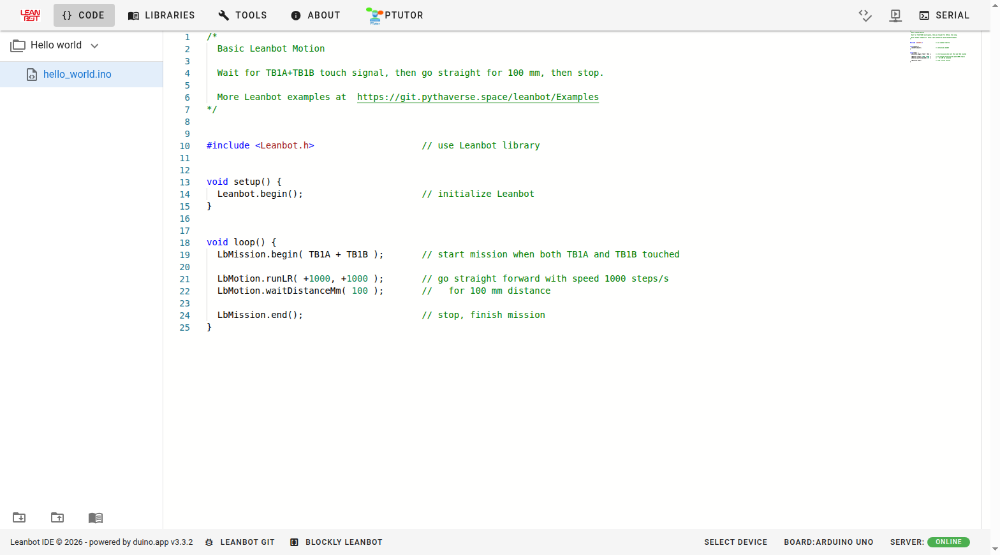
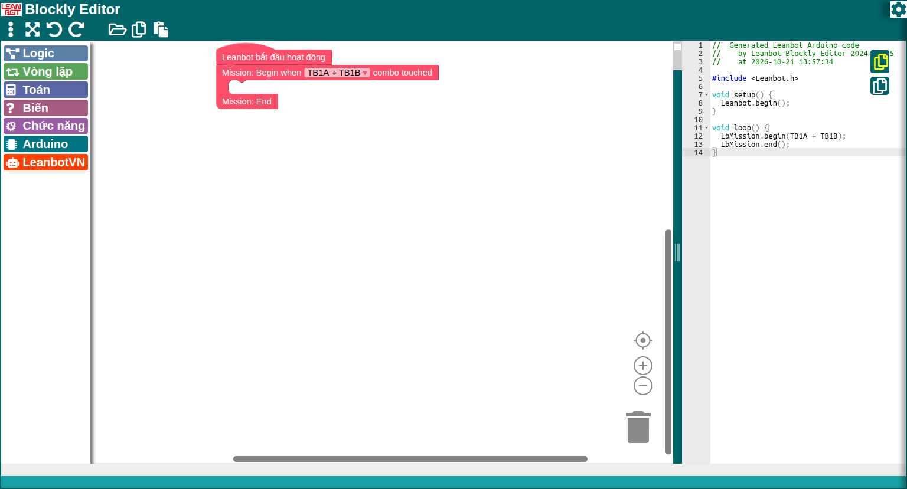
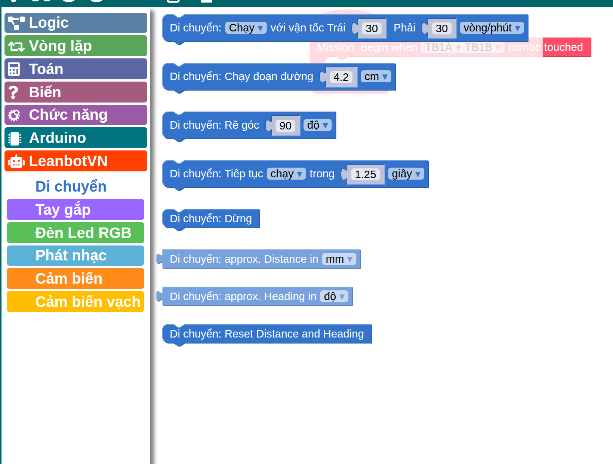

# Bài 0 — Bắt đầu: dùng Leanbot thế nào

Bài này không dạy lập trình. Nó dạy **mở cái gì, bấm vào đâu, code chạy từ máy sang robot
bằng đường nào**. Làm xong bài này, bé tự nạp được một chương trình vào robot mà không cần
hỏi ai. Chưa làm xong bài này thì 16 bài sau không chạy được.

Bài này tồn tại vì tài liệu gốc không có nó. Trang `leanbot.space/start/` mà hộp robot
hướng tới chỉ có hai câu ("sạc robot", "sang Pythaverse tạo tài khoản"), còn Documentation
Portal thì đòi đăng nhập bằng tài khoản có quyền đặc biệt. Xem mục "Ghi chú về bản gốc".

## Bé học xong thì làm được gì

- Nói đúng tên và công dụng của **5 địa chỉ web** của Pythaverse, mở được từng cái.
- Sạc robot và biết **khi nào sạc xong**.
- Bật robot, biết đèn nào báo robot đang sống.
- Ghép Bluetooth lần đầu cho robot.
- Nạp một chương trình từ trình soạn thảo vào robot qua cáp USB, **đọc được thông báo
  `100% – Done!`**, và biết nghe tiếng bíp để đoán robot đang làm gì.
- Khi cửa sổ chọn cổng hiện ra mà **trống rỗng**, biết phải làm gì.

## Cần chuẩn bị

| Thứ | Ghi chú |
|---|---|
| Leanbot + cáp USB | Cáp kèm trong hộp |
| Máy tính có **Chrome** hoặc **Edge** | **Firefox và Safari không nạp được** — xem mục "Vì sao phải là Chrome" |
| Tài khoản Pythaverse của lớp | HLV giữ. Không ghi mật khẩu vào đây |
| Mã Leanbot ID | In trên thân robot, dạng 6 ký tự |
| 2–4 tiếng để sạc | Lần đầu nên sạc đầy trước khi học |

## 1. Năm địa chỉ của Pythaverse

Đây là chỗ bé hay lạc nhất. Năm địa chỉ, mỗi cái một việc, dễ mở sai:

| Mở cái này | Để làm gì |
|---|---|
| `pythaverse.space` | Cửa trước. Đăng nhập rồi vào **Main Workspace** |
| `learn.pythaverse.space` | **PLearn** — bài học của khóa, slide và câu hỏi |
| `ide.pythaverse.space/#/code` | **Leanbot IDE** — viết code chữ (C++) và **nạp vào robot** |
| `ide.pythaverse.space/lbeditor/` | **Leanbot Blockly** — ghép khối lệnh. Đây là chỗ bé làm việc nhiều nhất |
| `git.pythaverse.space` | **PGit** — nơi lưu chương trình, cũng là nơi có chương trình mẫu chính thức |

Nhớ nhanh: **learn** là để *học*, **ide** là để *làm*, **git** là để *giữ*.

Mở `ide.pythaverse.space/#/code` thì thấy thế này — **không cần đăng nhập**:



Chỗ cần nhìn ngay là **thanh dưới cùng bên phải**:


| Chữ trên thanh | Nghĩa |
|---|---|
| `SELECT DEVICE` | Chọn robot. Sau khi chọn xong sẽ đổi thành `SERIAL: SELECTED` |
| `BOARD: ARDUINO UNO` | Loại mạch. **Phải là `ARDUINO UNO` hoặc `ARDUINO NANO`** |
| `SERVER: ONLINE` | Máy chủ biên dịch. Chữ này mà không xanh thì không nạp được, phải chờ |

Hai địa chỉ bắt đầu bằng `ide.` nhìn giống nhau nhưng **khác nhau**: `#/code` là trình viết
chữ, `lbeditor/` là trình ghép khối. Bé hạng Creator làm bài bằng `lbeditor/`.

> **Không phải `leanbot.space`.** Đó là trang giới thiệu sản phẩm, không phải nơi học.
> Trang `leanbot.space/documentations` đòi quyền đặc biệt, mở ra chỉ thấy *Access Denied*.

## 2. Sạc robot

1. Cắm sạc vào robot.
2. Chờ **2–4 tiếng**.
3. Nhìn **đèn LED phía trên cục pin**: còn **nháy** là còn đang sạc, **ngừng nháy** là sạc xong.

Robot gần hết pin thì động cơ chạy yếu và lệch, chương trình đúng vẫn ra kết quả sai. Hễ
robot "tự nhiên chạy sai" thì nghĩ tới pin trước khi nghĩ tới code.

## 3. Bật robot

Gạt công tắc trên thân robot. **Đèn đỏ sáng** là robot đang sống.

Thứ tự quan trọng: **bật robot trước, cắm USB sau**. Làm ngược lại thì máy tính có thể
không thấy cổng.

## 4. Ghép Bluetooth (chỉ lần đầu với mỗi robot)

Bước này chỉ cần cho Bản Sao Số và Gateway. Nạp code bằng cáp USB thì không cần.

1. Bật robot.
2. Trên máy tính, mở danh sách Bluetooth, tìm tên **`Leanbot XXXXXX BLE`** — `XXXXXX`
   là mã in trên thân robot.
3. Nếu máy hỏi mã ghép đôi, nhập **`1234`**.
4. Nghe **một tiếng bíp** là ghép xong.

Mỗi robot chỉ ghép một lần. Lần sau máy tự nhận.

## 5. Nạp chương trình vào robot — 6 bước

Đây là quy trình chính thức của Pythaverse. Làm đúng thứ tự:

| Bước | Làm gì | Thấy gì |
|---|---|---|
| 1 | Mở trình soạn thảo, có chương trình sẵn sàng | — |
| 2 | **Bật robot** | Đèn đỏ sáng |
| 3 | **Cắm cáp USB** từ máy sang robot | — |
| 4 | Bấm **`Compile & Upload`** | Chrome hiện cửa sổ *"muốn kết nối với cổng serial"* |
| 5 | Chọn đúng cổng trong danh sách → bấm **`Connect`** | Chạy 25 % → 50 % → … → **`100% – Done!`** |
| 6 | **Rút cáp USB** | Robot chạy chương trình mới |

**Board phải đặt là `ARDUINO UNO` hoặc `ARDUINO NANO`.** Đặt sai board thì nạp sẽ lỗi.

### Nút nạp nằm ở đâu — và vì sao khó tìm

Tài liệu Pythaverse gọi nó là nút `Compile & Upload`. **Trên màn hình không có chữ đó.**
Chỉ có hai biểu tượng nhỏ ở góc trên bên phải:


| Biểu tượng | Làm gì | Khi nào dùng |
|---|---|---|
| `< >` có dấu **tích** | **Chỉ biên dịch**, kiểm code có lỗi không. **Không** nạp vào robot | Khi muốn soát lỗi mà chưa cắm robot |
| Màn hình có nút **play** | **Biên dịch rồi nạp vào robot** | Đây là nút tài liệu gọi là `Compile & Upload` |
| `>_` **SERIAL** | Mở cửa sổ xem robot gửi chữ về máy | Bài 5 trở đi, khi cần xem số liệu cảm biến |

Bé hay bấm nhầm biểu tượng thứ nhất rồi tưởng đã nạp xong, vì nó cũng chạy và cũng báo
thành công — nhưng robot không hề nhận gì. **Nút đúng là nút có hình tam giác play.**

**Nghe tiếng bíp để biết robot đang làm gì:**

| Tiếng | Nghĩa |
|---|---|
| Một bíp khi bắt đầu nạp | Robot đã nhận lệnh, đang nạp |
| Một bíp, rồi "bíp bíp" | Nạp xong, robot sẵn sàng chạy |

**Tuyệt đối không rút cáp khi đang nạp.** Rút giữa lúc nạp thì chương trình trong robot
dở dang, phải nạp lại từ đầu.

**Ba tình huống ở bước 4–5:**

| Thấy gì | Làm gì |
|---|---|
| Không hiện cửa sổ nào, chạy luôn | Bình thường. Chrome còn nhớ cổng từ lần nạp trước |
| Hiện cửa sổ, có danh sách cổng | Chọn đúng cổng rồi bấm `Connect` |
| Hiện cửa sổ nhưng **danh sách trống** | **Rút cáp USB ra, cắm lại**, rồi chọn cổng. Không cần tải lại trang |

Không cần tải lại trang (F5) trước khi nạp.

## 6. Vì sao phải là Chrome

Cửa sổ "muốn kết nối với cổng serial" ở bước 4 là của **WebSerial** — một tính năng cho
phép trang web nói chuyện với thiết bị cắm vào máy. Trình soạn thảo của Pythaverse nạp code
bằng đúng tính năng này, nên:

- **Chrome, Edge: được.**
- **Firefox, Safari: không có WebSerial.** Nút `Compile & Upload` sẽ không mở được cổng nào.
  Không phải robot lỗi, không phải code sai.

Vì code đi từ *trang web* xuống *cổng USB*, nên **cổng USB phải tồn tại ở mức hệ điều hành
trước đã**. Mục 7 nói về chuyện đó.

## 7. Máy Linux: hai cái bẫy

Bỏ qua mục này nếu học trên Windows hoặc macOS.

Leanbot dùng chip chuyển USB–serial **CH340**. Trên Ubuntu có hai thứ chặn nó:

**Bẫy 1 — `brltty` giật cổng.** `brltty` là phần mềm hỗ trợ màn hình chữ nổi cho người
khiếm thị, có sẵn trong Ubuntu. Trong danh sách thiết bị của nó, chip CH340 bị nhận nhầm là
màn hình chữ nổi Baum. Hậu quả: cắm robot vào thì cổng sinh ra rồi **mất sau một giây**:

```
ch341-uart converter now attached to ttyUSB0          ← cổng đã tạo
usbfs: interface 0 claimed by ch341 while 'brltty' sets config #1
ch341-uart converter now disconnected from ttyUSB0    ← bị lấy mất
```

Xem log này bằng `journalctl -k | grep ch341`. Cách sửa:

```bash
sudo systemctl stop brltty-udev.service
sudo systemctl mask brltty-udev.service brltty.service
```

Lệnh này **tắt hẳn hỗ trợ màn hình chữ nổi** trên máy đó. Nếu trong nhà có người dùng thiết
bị chữ nổi thì đừng dùng cách này; thay vào đó viết một luật udev chỉ loại trừ đúng
`1a86:7523`.

**Bẫy 2 — không có quyền mở cổng.** Node cổng thuộc `root:dialout` với quyền 660, nên
người dùng thường không mở được:

```bash
sudo usermod -aG dialout "$USER"
```

Phải **đăng xuất rồi đăng nhập lại** mới có hiệu lực.

Kiểm xem đã xong chưa:

```bash
ls -l /dev/ttyUSB*     # phải thấy /dev/ttyUSB0, và nó không biến mất
```

Cổng còn phải **tồn tại bền**, không chỉ loé lên rồi tắt. Cắm rồi đợi 5 giây rồi kiểm lại.

**Hai bẫy này cho ra hai triệu chứng khác hẳn nhau.** Phân biệt được thì sửa đúng chỗ:

| Thấy gì khi bấm nút nạp | Bẫy nào | Sửa |
|---|---|---|
| Cửa sổ chọn cổng hiện ra nhưng **danh sách trống** | Bẫy 1: `brltty` đã giật mất cổng | `mask brltty` |
| Chọn được cổng, biên dịch xong tới ~50 %, rồi báo `*** Upload Error: Failed to execute 'open' on 'SerialPort': Failed to open serial port.` | Bẫy 2: thiếu nhóm `dialout` | Thêm nhóm **rồi đăng xuất đăng nhập lại** |

Thông báo ở hàng thứ hai hay làm người ta tưởng robot hỏng, vì dòng ngay trên nó in ra
`Sketch uses 11918 bytes (36%) of program storage space` — tức **code đã biên dịch xong
hoàn toàn**. Chỉ riêng bước mở cổng bị hệ điều hành từ chối.

**Quan trọng:** thêm nhóm `dialout` xong thì **Chrome đang mở vẫn chưa có quyền**, vì
tiến trình Chrome thừa hưởng nhóm từ lúc nó khởi động. Phải **đăng xuất rồi đăng nhập
lại** (hoặc khởi động lại máy), sau đó mở Chrome mới. Kiểm nhanh xem phiên hiện tại đã có
chưa:

```bash
id -nG | tr ' ' '\n' | grep -x dialout    # in ra "dialout" là xong
```

## 8. Trình ghép khối — nơi bé làm việc

Mở `ide.pythaverse.space/lbeditor/?lang=vi`. Thêm `?lang=vi` để có nhãn tiếng Việt ngay;
không có nó thì mở menu bánh răng ⚙ góc phải rồi chọn `Tiếng Việt`.



Màn hình chia ba cột:

| Cột | Là gì |
|---|---|
| **Trái** | Danh mục khối. Bấm vào tên danh mục thì khay khối mở ra |
| **Giữa** | Chỗ ghép khối. Ba khối màu hồng có sẵn là khung chương trình, **đừng xóa** |
| **Phải** | **Code C++ sinh ra, cập nhật ngay khi bé kéo khối.** Đây là cột quý nhất |

Cột phải chính là chỗ áp dụng cách học **nhìn và học song song** của khóa: bé kéo một khối,
mắt liếc sang phải xem dòng lệnh nào vừa xuất hiện. Lâu dần bé đọc được C++ mà không cần
ai dạy riêng.

### Danh mục khối của Leanbot

Khối của robot nằm trong danh mục màu cam **`LeanbotVN`**. Bấm vào nó sẽ xổ ra 6 nhóm con:



| Nhóm con | Dạy ở bài |
|---|---|
| **Di chuyển** | Bài 1 |
| **Tay gắp** | Bài 2 |
| **Đèn Led RGB** | Bài 2, 14 |
| **Phát nhạc** | Bài 7 |
| **Cảm biến** | Bài 3 |
| **Cảm biến vạch** | Bài 4 |

### Đơn vị nằm ngay trên khối

Nhìn kỹ ảnh trên: mỗi khối có một **ô chọn đơn vị** ở cuối. Đây là chỗ gây lẫn lộn nhiều
nhất giữa bài học và chương trình mẫu, nên nhớ kỹ:

| Khối | Ô chọn | Hai lựa chọn |
|---|---|---|
| `Di chuyển: Chạy với vận tốc Trái … Phải …` | đơn vị vận tốc | **`vòng/phút`** hoặc **`bước/giây`** |
| `Di chuyển: Chạy đoạn đường …` | đơn vị dài | **`cm`** hoặc **`mm`** |
| `Di chuyển: Tiếp tục chạy trong …` | đơn vị thời gian | **`giây`** hoặc **`mili giây`** |
| `Di chuyển: Rẽ góc …` | đơn vị góc | chỉ có **`độ`** |

Cùng một khối, đổi ô chọn là đổi hẳn ý nghĩa con số. Bài học của khóa viết theo `vòng/phút`
và `cm`; **mọi chương trình mẫu chính thức lại dùng `bước/giây` và `mm`**. Robot không sai,
chỉ là hai cách ghi cùng một việc. Khi so chương trình của bé với chương trình mẫu, **nhìn
ô chọn trước khi kết luận số sai**.

Khối cũng ghi sẵn giá trị mặc định: vận tốc `30` / `30`, quãng đường `4.2 cm`, rẽ `90 độ`,
tiếp tục `1.25 giây`. Bé chỉ việc sửa số trong ô.

### Nhãn còn tiếng Anh

Trong ảnh có ba khối còn nguyên tiếng Anh: `Di chuyển: approx. Distance in mm`,
`approx. Heading in độ`, `Reset Distance and Heading`. Khối khung chương trình cũng vậy —
`Mission: Begin when TB1A + TB1B combo touched` và `Mission: End` chưa dịch. Bản dịch sẵn
có của Pythaverse mới xong 13 trong 48 khối.

Muốn thấy toàn bộ nhãn tiếng Việt, cài bản vá của chúng ta theo hướng dẫn trong
[`../../../tools/lbeditor-vi/README.md`](../../../tools/lbeditor-vi/README.md). Bản vá chỉ
đổi chữ hiển thị, **không đụng tới code sinh ra** — đã kiểm bằng cách so từng dòng trước và
sau khi vá.

## Phiếu ôn luyện

**Câu 1.** Bé muốn ghép khối lệnh cho robot thật. Mở địa chỉ nào?

**Đáp án:** `ide.pythaverse.space/lbeditor/`. `learn.pythaverse.space` là nơi xem bài học
chứ không ghép khối được; `ide.pythaverse.space/#/code` là trình viết code chữ.

**Câu 2.** Sắp xếp lại cho đúng thứ tự: (a) bấm `Compile & Upload`, (b) cắm cáp USB,
(c) rút cáp USB, (d) bật công tắc robot, (e) chọn cổng rồi bấm `Connect`.

**Đáp án:** (d) → (b) → (a) → (e) → (c). Bật robot **trước** khi cắm cáp. Rút cáp là bước
cuối cùng, sau khi thấy `100% – Done!`.

**Câu 3.** Bé bấm `Compile & Upload`, cửa sổ chọn cổng hiện ra nhưng danh sách **trống**.
Làm gì?

**Đáp án:** Rút cáp USB ra rồi cắm lại, sau đó chọn cổng. Không cần tải lại trang, không
cần khởi động lại máy, không cần nạp lại chương trình từ đầu.

**Câu 4.** Bạn của bé mở trình soạn thảo bằng Firefox, ghép khối xong, bấm
`Compile & Upload` nhưng không có cửa sổ nào hiện ra. Robot có hỏng không?

**Đáp án:** Robot không hỏng. Firefox không có WebSerial nên trang web không mở được cổng
USB. Chuyển sang Chrome hoặc Edge là nạp được ngay, không phải sửa gì trong chương trình.

**Câu 5.** Robot đang nạp dở, bé sốt ruột rút cáp. Chuyện gì xảy ra?

**Đáp án:** Chương trình trong robot dở dang, robot không chạy đúng. Phải cắm lại và nạp
lại từ đầu. Không hỏng robot, nhưng mất công.

**Câu 6.** Chương trình bé viết đúng hệt lần trước, mà hôm nay robot chạy lệch hẳn sang
một bên. Nghĩ tới nguyên nhân nào trước?

**Đáp án:** **Pin yếu**. Pin yếu thì hai động cơ không còn khoẻ bằng nhau nên robot lệch,
dù code không đổi một chữ. Kiểm đèn LED trên pin trước khi sửa code.

**Câu 7.** Bé bấm biểu tượng `< >` có dấu tích. Máy báo thành công, nhưng robot đứng im
không làm gì. Vì sao?

**Đáp án:** Đó là nút **chỉ biên dịch**, không nạp vào robot. Nó báo "thành công" nghĩa là
code không có lỗi cú pháp, chứ không phải đã vào robot. Phải bấm biểu tượng **màn hình có
nút play** mới nạp.

**Câu 8.** Chương trình mẫu của ban tổ chức ghi vận tốc `2000`, còn bài học dạy vận tốc
`30`. Số nào đúng?

**Đáp án:** **Cả hai đều đúng**, vì khác đơn vị. Bài học dùng ô chọn `vòng/phút` (tối đa 59),
chương trình mẫu dùng ô chọn `bước/giây` (2000 là chạy gần hết cỡ). Nhìn **ô chọn đơn vị**
trên khối trước khi kết luận số nào sai.

## Bé hay vướng ở đâu

- **Mở sai địa chỉ.** `learn.` và `ide.` dễ lẫn, mà hai cái `ide.` lại càng dễ lẫn hơn.
  Nên đặt sẵn 5 dấu trang (bookmark) trên máy cho bé, đặt tên tiếng Việt.
- **Cắm USB trước khi bật robot**, rồi kết luận "máy không nhận robot".
- **Rút cáp sớm**, lúc mới thấy 50 %.
- **Tưởng `100% – Done!` là robot đã chạy.** Chưa: phải rút cáp thì robot mới chạy chương
  trình mới.
- **Quên sạc.** Đây là nguyên nhân số một của "code đúng mà robot chạy sai".

## Ghi chú về bản gốc

Bài này do chúng ta viết, không có trong khóa gốc. Những chỗ hở của tài liệu nhà sản xuất,
tính đến ngày 21/10/2026:

- **`leanbot.space/start/` không phải hướng dẫn sử dụng.** Hộp robot và trang chủ đều dẫn
  tới đây, nhưng nó chỉ có hai bước: sạc robot, và sang `pythaverse.space/start/` tạo tài
  khoản. Không có một chữ nào về cách nạp code.
- **`pythaverse.space/start/` cũng chỉ có một câu**: tạo tài khoản học sinh rồi kích hoạt
  Leanbot ID.
- **`leanbot.space/documentations` trả về *Access Denied*** cho người thường, đòi tài khoản
  có quyền. Đây gần như chắc chắn là lý do người mua robot không tìm được hướng dẫn.
- **Hướng dẫn thật nằm ở `pythaverse.space/docs/`** mà không có link nào từ hai trang
  `/start/` dẫn tới. Quy trình 6 bước ở mục 5 lấy từ hai bài trong đó:
  `how-to-upload-coding-program-on-leanbot` và `how-to-reload-the-program-for-leanbot`.
- **Hai bài hướng dẫn nạp code nói khác nhau về tên nút**: một bài ghi
  `Compile & Upload`, bài kia chỉ ghi `Compile`. Nút thật trên trình soạn thảo cần HLV
  xác nhận lại.
- **Hướng dẫn cài driver của Pythaverse viết cho Windows 7 bản 32-bit**, tức khoảng năm
  2009. Không có bản cho Windows 10/11, macOS hay Linux.
- **"Troubleshooting guide" của Pythaverse không nói gì về robot.** Toàn bộ nội dung là
  xoá cache trình duyệt, khởi động lại máy, đổi mạng, gửi ticket. Không một dòng về cổng
  COM, driver, pin, động cơ hay cảm biến. Bảng khắc phục sự cố dùng được nằm ở
  [`../../playbooks/leanbot-setup.md`](../../playbooks/leanbot-setup.md).
- **"Student Workspace User Guide" là trang trống** — chỉ có tiêu đề và nhãn
  "less than 1 min read".
- Mục 7 (Linux) hoàn toàn do chúng ta tìm ra khi cắm robot thật vào máy Ubuntu ngày
  21/10/2026. Không tài liệu nào của nhà sản xuất nhắc tới `brltty` hay nhóm `dialout`.
